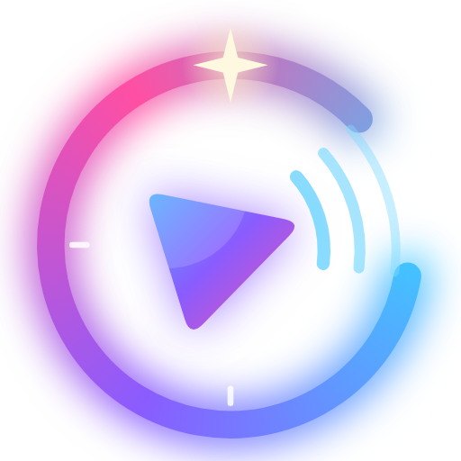

  

<h1 align="center">Lucid Hub</h1>

  Tu música, en tu teléfono y sin anuncios. Con respaldo local y en la nube.

  <a href="https://github.com/LibreLabsprojects/lucid-hub-releases/releases/latest"><b>⬇️ Descargar la última versión</b></a>

---

Lucid Hub es un reproductor para la música que ya tienes en tu teléfono Android: playlists, letras con karaoke y traducción, carátulas, ecualizador, temas (incluidos los retro con aspecto de MP3), copias de seguridad, **compartir música con teléfonos cercanos y sincronizar tus teléfonos, sin internet**.

Este repositorio es solo para **descargar la app**. Cada versión está en [Releases](https://github.com/LibreLabsprojects/lucid-hub-releases/releases), con sus novedades.

## ¿Cuál descargo?

En cada versión hay dos archivos:

| Archivo | Para quién |
|---|---|
| **`LucidHub-x.x.x.apk`** | **Casi todos los teléfonos.** Empieza por este. |
| **`LucidHub-x.x.x-32bits.apk`** | Teléfonos con Android de 32 bits: úsalo **si el otro dice "App no instalada"** o "El paquete no es válido". |

Pistas de que tu teléfono es de 32 bits:

- Es **económico o tiene varios años** (por ejemplo, de 2020 o antes).
- Tiene **2 GB de RAM o menos**.
- Trae **Android 9 o anterior**, o es una edición **Android Go**.

Ojo: lo que cuenta es el **Android que trae**, no solo el procesador. Hay teléfonos con procesador de 64 bits que vienen con Android de 32 bits para ahorrar memoria (como el Moto E6s). Si quieres saberlo con seguridad, una app como **CPU-Z** lo muestra en *Sistema → Arquitectura del kernel* (`armv7` o `armeabi-v7a` es 32 bits; `aarch64` o `arm64` es 64 bits).

## Cómo instalarla

1. Abre [la última versión](https://github.com/LibreLabsprojects/lucid-hub-releases/releases/latest) y descarga el archivo que te corresponde (mejor con Wi-Fi: pesa unos 40 MB).
2. Ábrelo desde las notificaciones o desde la carpeta Descargas.
3. Si Android lo pide, permite **instalar apps de esta fuente** (es una app que no viene de Play Store).
4. Toca **Instalar**.

**Para actualizar:** desde la versión 1.6.0, la app te avisa en Inicio cuando hay una versión nueva y la instala por ti (también en *Ajustes → Información → Buscar actualizaciones*). Si tienes una versión anterior, actualiza a mano una última vez: descarga la nueva (del mismo tipo: 32 bits si usabas esa) y ábrela. Se instala encima y conserva tus playlists, nombres, carátulas y ajustes.

Necesita **Android 7.0 o más nuevo**.

## Privacidad

- Tu música se queda en tu teléfono: nunca se sube a ningún lado.
- La app pide permiso para leer tu **música** (no tus fotos ni videos).
- Al **compartir con un teléfono cercano**, las canciones van directo de un teléfono al otro, sin pasar por internet. Para buscar teléfonos, Android pide **"Dispositivos cercanos"** y **"Ubicación"**: la app no usa ni guarda tu ubicación, y solo los pide cuando entras a compartir.
- Se conecta a internet para buscar carátulas, nombres, letras y fotos de artistas en bases de datos abiertas (MusicBrainz, Cover Art Archive, LRCLIB y Wikimedia) y, si lo activas, en iTunes. Solo envía el nombre de la canción o del artista.
- Una vez al día, la app pregunta aquí, en GitHub, si hay una versión nueva (se puede desactivar). Para instalar las actualizaciones, Android pide permitir que Lucid Hub **instale apps**, y siempre pregunta antes de instalar.
- La cuenta de Google es **opcional**: solo sirve para guardar tus copias de seguridad en la nube, donde solo tú puedes verlas.

## Contacto

Sugerencias o problemas: **librelabsconsultas@proton.me**

Hecho por **Libre Labs**.
